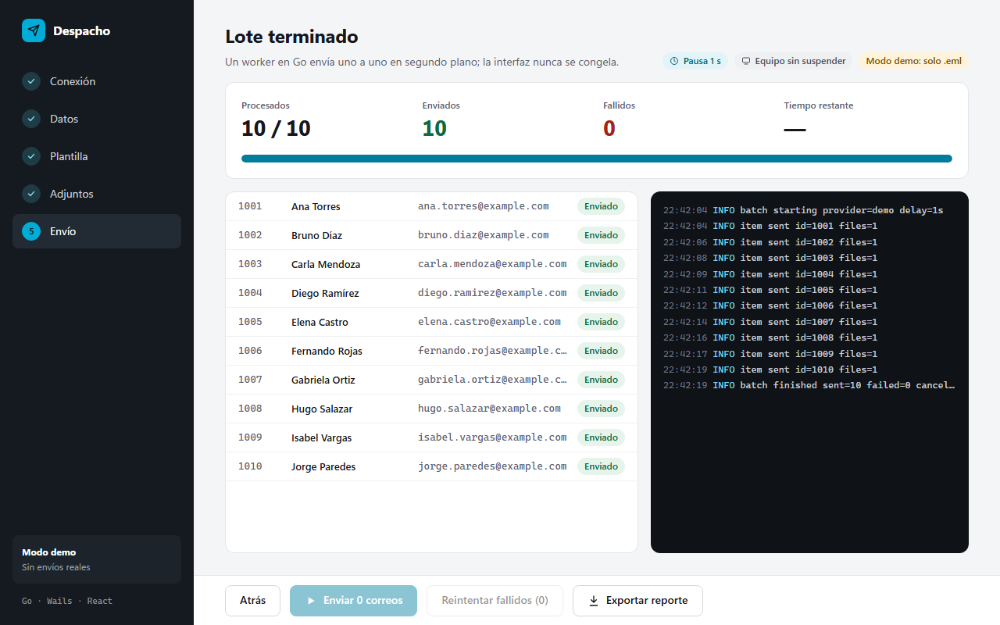
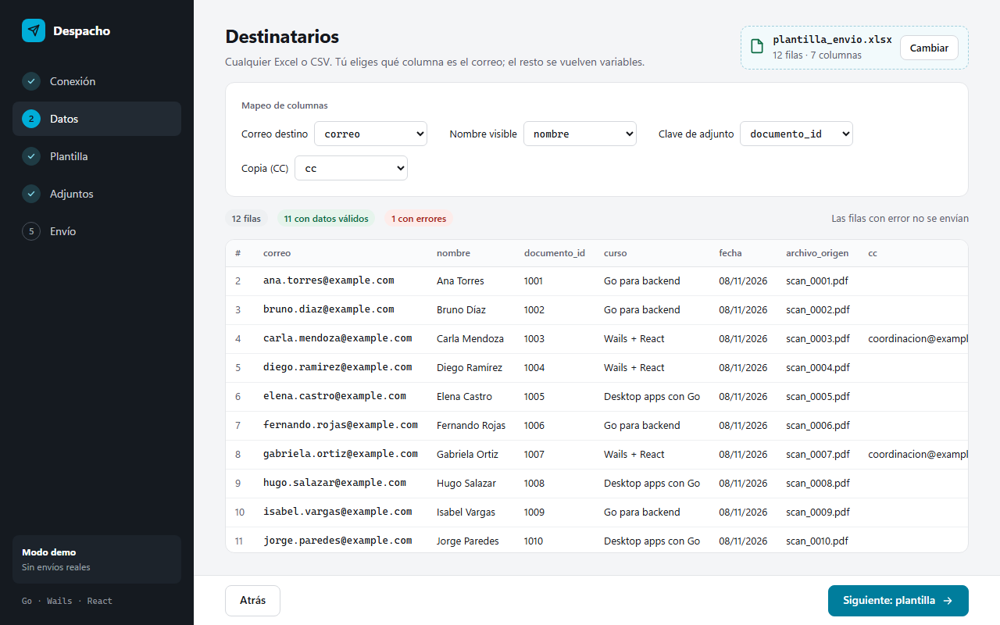
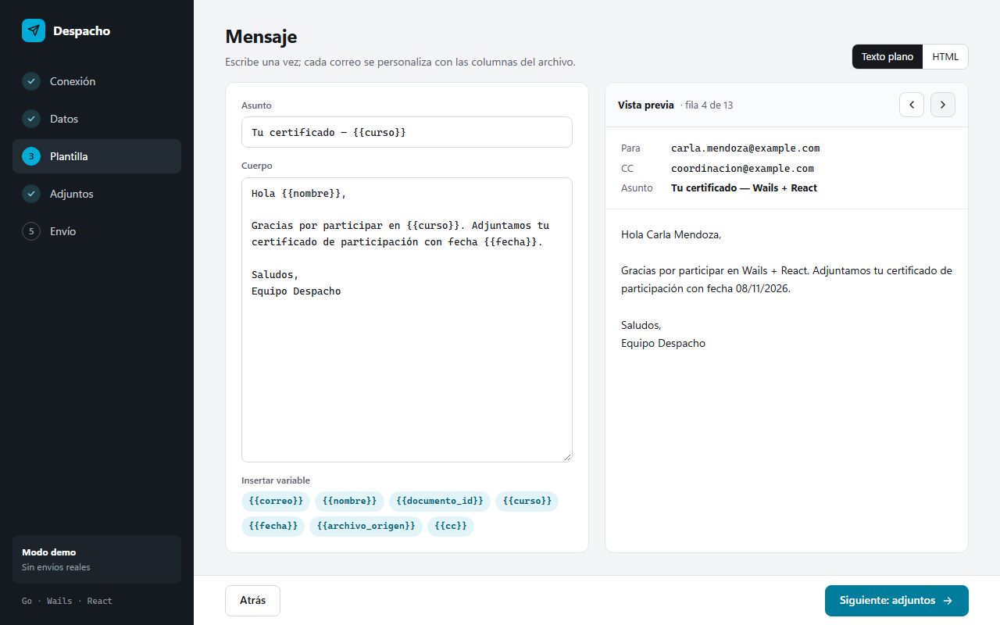
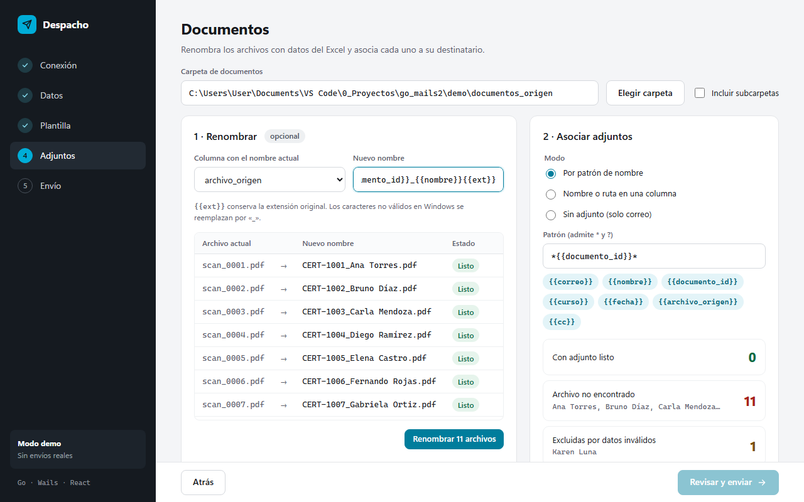
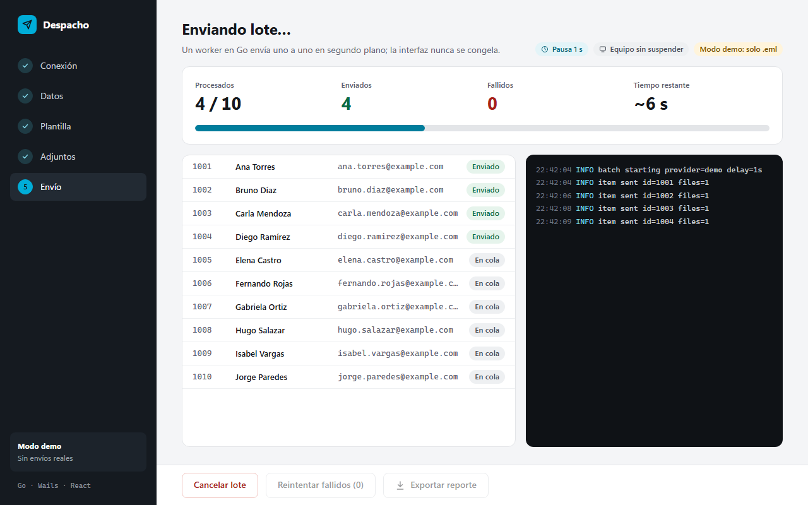
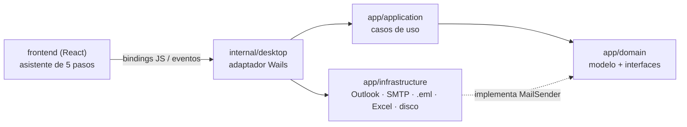

# Despacho

**Envío masivo de documentos personalizados (boletas de pago, certificados, facturas)
desde tu propia cuenta de correo, en un solo `.exe` para Windows.**




---

## El problema

Una pequeña empresa tiene que enviar cada mes cientos de documentos individuales:
boletas de pago a sus trabajadores, certificados a los asistentes de un curso o
facturas a sus clientes. Sin una herramienta, el proceso es manual:

1. Escanear los documentos y **renombrarlos uno por uno** para saber de quién es cada PDF.
2. Mantener un Excel con los destinatarios (nombre, DNI, correo).
3. Abrir Outlook y **redactar cientos de correos**, adjuntando a mano el archivo correcto.
4. Llevar la cuenta, también a mano, de qué se envió y qué falló.

Con lotes de **50 a 500 documentos**, este trabajo consume horas. Además, adjuntar
la boleta de una persona en el correo de otra es una fuga de datos personales.

Las herramientas de mailing masivo no resuelven este caso. Sirven para newsletters,
no para enviar a cada destinatario **un archivo distinto**. Además, exigen subir datos
sensibles a la nube y envían desde un dominio ajeno. El cliente original tenía estas
restricciones:

- Los correos deben salir **de su propia cuenta** (Outlook o Gmail), para que el
  destinatario reconozca al remitente.
- No hay equipo de TI: nada de servidores, cuentas de Google Cloud ni OAuth.
- La herramienta debe instalarse sin esfuerzo: **un único ejecutable**, sin Python,
  Node ni otros runtimes.

## La solución

Despacho es un asistente de escritorio de 5 pasos que convierte ese proceso en minutos:

| Paso | Qué hace |
|---|---|
| **1. Conexión** | Outlook Classic (elige la cuenta del perfil local), SMTP con presets (Gmail con contraseña de aplicación, Zoho o un servidor propio) o **modo demo**, que guarda cada correo como `.eml` y no envía nada. |
| **2. Datos** | Lee cualquier `.xlsx` o `.csv`. Eliges qué columna es el correo, el nombre, la copia (CC) y la clave del documento. **Cada columna se vuelve una variable** `{{columna}}`. |
| **3. Plantilla** | Asunto y cuerpo (texto o HTML) con vista previa por destinatario. La vista previa la genera el mismo código Go que envía. |
| **4. Adjuntos** | Renombra los archivos escaneados con una regla (`CERT-{{documento_id}}_{{nombre}}{{ext}}`), con vista previa, detección de conflictos y deshacer. Luego asocia cada adjunto por patrón o por columna. |
| **5. Envío** | Valida el lote completo **antes** de enviar. Envía en segundo plano con una pausa configurable entre correos y permite cancelar. Puedes reintentar solo los fallidos y exportar el reporte a Excel. Windows no entra en suspensión mientras hay un lote en curso. |

### Demo

Un [video de 48 segundos](docs/demo/despacho-demo.mp4) recorre el flujo completo. Estos
son algunos pasos:

| Datos validados | Vista previa de la plantilla |
|---|---|
|  |  |
| **Renombrado con vista previa** | **Envío en curso** |
|  |  |

Las capturas y el video se generan automáticamente con Playwright, que recorre la app
real en modo demo (ver [scripts/demo-recorder](scripts/demo-recorder/record.mjs)).

---

## Probarlo

El modo demo no necesita ninguna cuenta de correo: cada mensaje se escribe como un
archivo `.eml` que puedes abrir con cualquier cliente de correo.

### Requisitos

| Herramienta | Versión | Notas |
|---|---|---|
| Windows | 10 u 11 | Único target soportado (Outlook se controla por COM). |
| [Go](https://go.dev/dl/) | 1.25+ | |
| [Node.js](https://nodejs.org/) | 20.19+ | Lo exige Vite 7. |
| [Wails CLI](https://wails.io/docs/gettingstarted/installation) | **v2.15** | La misma versión que `go.mod`. Las versiones anteriores fallan al analizar paquetes de Go recientes. |
| WebView2 Runtime | — | Viene preinstalado en Windows 11. |
| gcc (opcional) | — | Solo para `go test -race`, que requiere CGO. Por ejemplo, [WinLibs](https://winlibs.com/) o MSYS2. |

### 1. Instalar

```powershell
git clone https://github.com/Merlin2098/go_mails.git
cd go_mails

go install github.com/wailsapp/wails/v2/cmd/wails@v2.15.0
wails doctor                        # debe terminar en "Your system is ready"

cd frontend; npm install; cd ..
```

### 2. Generar datos de prueba

```powershell
.\scripts\demo-data.ps1             # Excel con 12 destinatarios ficticios + 11 PDFs en .\demo
.\scripts\demo-data.ps1 -Count 100  # lote más grande
```

En Git Bash: `scripts/demo-data.sh -n 100`. El script borra la carpeta `demo/` antes de
generar, así cada prueba parte de PDFs sin renombrar.

Todas las direcciones usan `example.com`, un dominio reservado al que nunca llega nada.
Los datos traen **dos errores a propósito**, para ver la validación en acción: un correo
inválido y un PDF que falta.

### 3. Ejecutar

```powershell
wails dev                           # abre la app con recarga en caliente
```

En la app:

1. **Conexión:** elige **Modo demo**. Los `.eml` se guardan por defecto en
   `Documentos\Despacho\salida_demo`.
2. **Datos:** carga `demo/plantilla_envio.xlsx`. El mapeo de columnas se sugiere solo,
   y la plantilla del mensaje viene incluida en el mismo Excel.
3. **Plantilla:** edita el asunto o el cuerpo y revisa la vista previa de cada destinatario.
4. **Adjuntos:** elige `demo/documentos_origen`, aplica la regla de renombrado y revisa
   el emparejamiento.
5. **Envío:** valida, envía y exporta el reporte. Los dos registros con errores quedan
   marcados y no se envían.

### 4. Tests

```powershell
go test ./...                       # unitarios + flujo end-to-end con los datos de demo
go test -race ./...                 # lo mismo con el detector de data races (requiere gcc)
```

El test de [internal/demodata](internal/demodata/flow_test.go) ejecuta el flujo completo
(leer Excel → renombrar → validar → enviar en modo demo) sin interfaz y sin red.

### 5. Generar el ejecutable

```powershell
wails build                         # build/bin/Despacho.exe (~15 MB, sin dependencias)
```

Al abrir el `.exe` en otra máquina, Windows SmartScreen puede advertir que la app no
está firmada. [docs/dev_setup.md §7.5](docs/dev_setup.md) explica cómo desbloquearlo y
qué opciones de firma de código existen.

### Envío real (opcional)

- **Gmail:** requiere una [contraseña de aplicación](https://myaccount.google.com/apppasswords)
  (necesita la verificación en dos pasos activa). No es la contraseña de tu cuenta.
- **Outlook:** requiere Outlook Classic de escritorio con al menos una cuenta configurada.
  La versión "nuevo Outlook" no expone COM.
- Para probar con correos reales sin molestar a nadie, genera los datos con tu bandeja
  como destino. Cada destinatario se vuelve un alias `tucorreo+nombre@...`:

  ```powershell
  go run ./cmd/demodata -inbox tucorreo@gmail.com
  ```

---

## Arquitectura

Despacho es una app [Wails](https://wails.io): un binario Go que embebe el frontend
React y lo muestra en el WebView2 de Windows. No hay servidor HTTP ni puertos abiertos.
Wails expone los métodos de los structs de Go como funciones JavaScript tipadas y
envía eventos de progreso del backend a la UI.

El backend sigue una arquitectura por capas: las dependencias apuntan hacia el dominio,
y el dominio no depende de nada.



```text
main.go                 embebe el frontend y arranca Wails (vive en la raíz: //go:embed no admite "..")
internal/desktop        capa Wails: cada struct enlazado se vuelve un módulo JS
  ├─ services.go        arma las dependencias a mano (sin framework de inyección)
  ├─ app.go             diálogos nativos y abrir enlaces
  ├─ providers.go       ProviderService: cuenta activa y límites (sesión inmutable por lote)
  ├─ campaign.go        CampaignService: datos, validación, worker de envío y eventos
  └─ rename.go          RenameService: vista previa, aplicar y deshacer
app/domain              Recipient, Template {{vars}}, Batch, MailSender (sin dependencias)
app/application         BuildBatch, RunBatch, PlanRename (casos de uso, testeables)
app/infrastructure
  ├─ outlook            COM con go-ole (hilo fijado con runtime.LockOSThread)
  ├─ smtpmail           net/smtp + STARTTLS/TLS, presets
  ├─ demomail           escribe .eml
  ├─ mailmime           RFC 5322: quoted-printable, base64 a 76 columnas, nombres con acentos
  ├─ spreadsheet        excelize + encoding/csv (detecta ; o ,)
  ├─ filesystem         índice de archivos, búsqueda sin distinguir mayúsculas
  ├─ winpath            rutas largas (>260) para la API COM de Outlook
  ├─ power              SetThreadExecutionState (evita la suspensión)
  └─ logging            log/slog a archivo
internal/demodata       generador de datos ficticios + test end-to-end
cmd/demodata            CLI del generador
frontend/src            React 19 + TypeScript: un componente por paso, estado en useReducer
```

### Decisiones de diseño

- **Go + Wails en lugar de Electron o Python.** Un solo `.exe` de ~15 MB que usa el
  WebView2 que Windows ya trae. Con PyInstaller o Electron el ejecutable pesaría
  10 veces más y tardaría más en arrancar.
- **SMTP con contraseña de aplicación en lugar de la API de Gmail.** OAuth obliga a
  crear un proyecto en Google Cloud y pasar la verificación de la app. Para un usuario
  sin TI, pegar una contraseña de aplicación es mucho más simple.
  ([spec](docs/specs/POC_Gmail_Desktop.md))
- **Outlook por COM en lugar de Microsoft Graph.** El correo sale de la cuenta ya
  configurada en el equipo y queda en "Enviados", sin registrar una app en Azure.
  ([spec](docs/specs/POC_Outlook_Hotmail_Desktop.md))
- **Interfaces del lado del consumidor.** `domain.MailSender` y
  `application.DocumentIndex` permiten probar todo el flujo sin Outlook ni disco.
- **Hilos del sistema operativo.** COM y `SetThreadExecutionState` funcionan por hilo.
  Por eso `outlook` y `power` usan `runtime.LockOSThread`.
- **Sin data races.** El worker envía sobre una copia del lote y aplica cada cambio
  bajo un mutex. El código pasa `go test -race`.
- **Cancelación con `context`.** Cancelar también interrumpe la pausa entre correos
  (`select` sobre `ctx.Done()`).
- **Validar antes de enviar.** El lote completo se valida (correos, variables de la
  plantilla, adjuntos que existen) antes de enviar el primer correo. Un error se
  descubre en la pantalla, no a mitad del envío.

## Seguridad y privacidad

- Las credenciales SMTP viven **solo en memoria** mientras la app está abierta. Nunca
  se escriben en disco.
- Los logs (`logs/app.log`, junto al `.exe`) registran la clave de cada documento y su
  estado, **nunca** el cuerpo de los mensajes ni las contraseñas.
- Todo se procesa en el equipo: no hay backend, telemetría ni servicios de terceros
  aparte de tu propio proveedor de correo.

## Limitaciones conocidas

- Solo Windows. Outlook COM y la prevención de suspensión son APIs de Windows.
- El envío es secuencial y respeta una pausa entre correos para no superar los límites
  de tu proveedor (Gmail permite unos 500 correos diarios en cuentas personales).
- El ejecutable no está firmado digitalmente.

## Documentación adicional

La carpeta [docs/](docs/) guarda la documentación de diseño escrita durante el desarrollo.
"BoletaMailer" era el nombre de trabajo del proyecto.

- [docs/boleta_mailer_mvp_context.md](docs/boleta_mailer_mvp_context.md): contexto de
  negocio, alcance y requisitos del MVP.
- [docs/dev_setup.md](docs/dev_setup.md): guía detallada del entorno de desarrollo,
  build y SmartScreen.
- [docs/specs/](docs/specs/): pruebas de concepto de Gmail y Outlook, especificación
  de la UI y enrutamiento de documentos.

## Licencia

[MIT](LICENSE)
